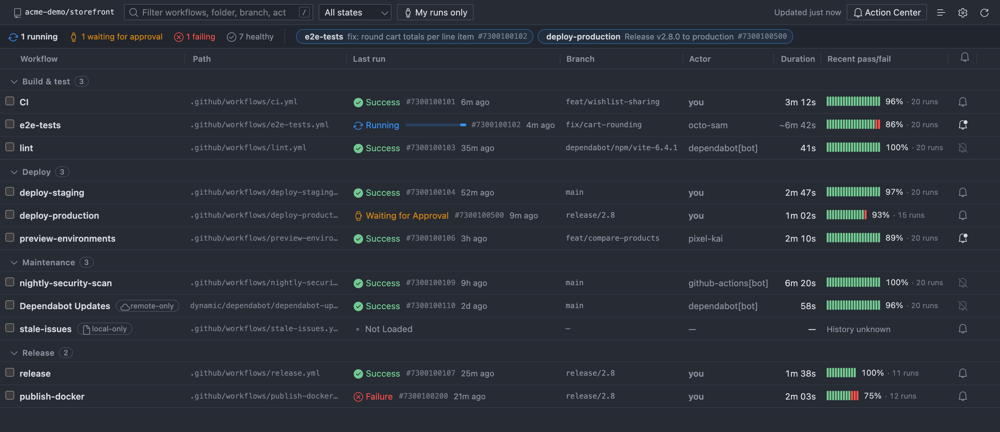
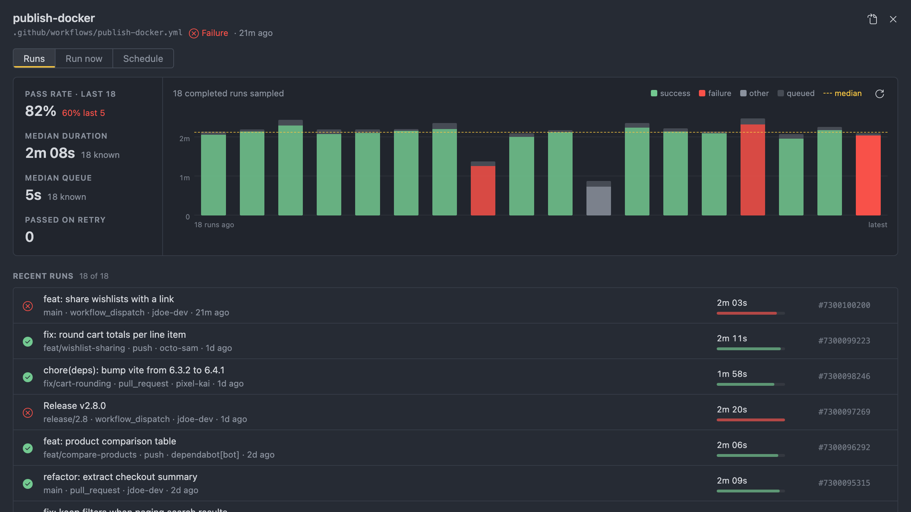
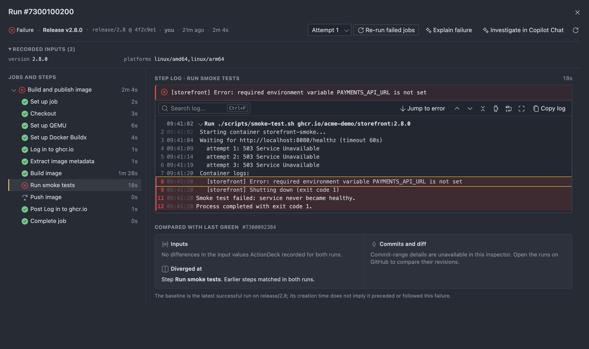
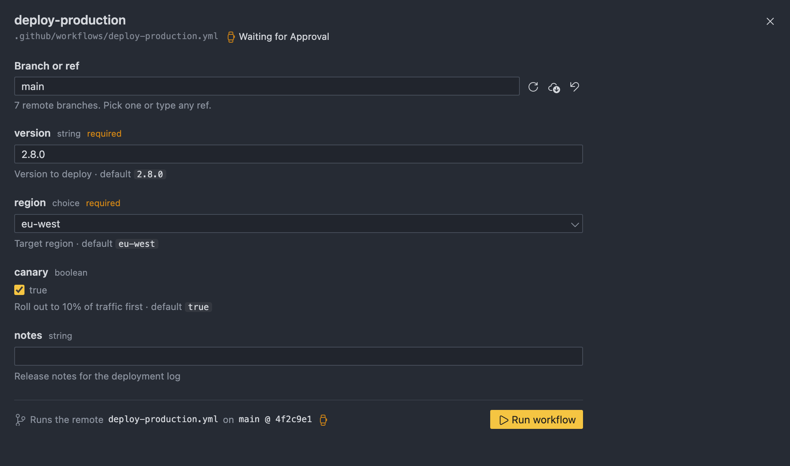
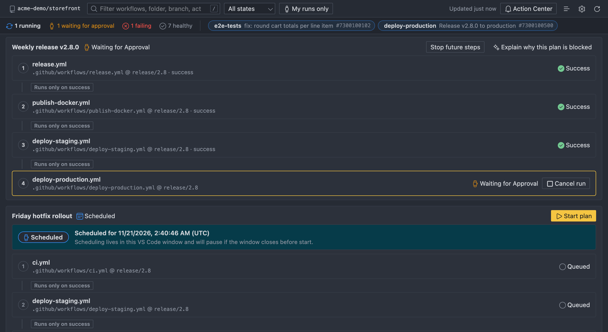
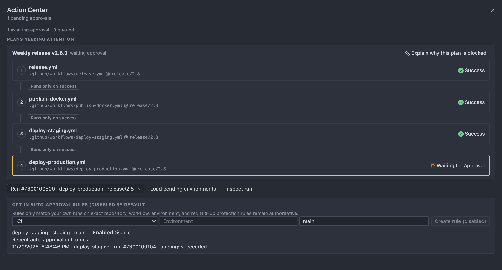

# ActionDeck

**Run, monitor and ship your GitHub Actions workflows without leaving VS Code.**

ActionDeck brings your repository's CI/CD into the editor. See every workflow at a glance, start runs with validated inputs, investigate failures down to the exact log line, chain workflows into release plans and approve deployments, all from one place.

## Highlights

- **Repository dashboard**: every workflow in one table with status, pass rate, duration and recent history.
- **Release plans**: chain workflows into a gated sequence such as build → staging → production, then run it now or schedule it.
- **Approvals in the editor**: review pending deployments and set optional auto-approval rules for your own runs.
- **Validated dispatch**: inputs are loaded from the exact branch or tag you pick and checked before anything runs.
- **Fast failure triage**: open a run and land on the failing step and error line, then compare it with the last successful run.
- **Secure by design**: sign in with VS Code's built-in GitHub account. No tokens to paste, no credentials stored.

## Features

### Dashboard

Your local workflow files and their GitHub runs side by side. Each row shows the latest run, branch, who triggered it, duration and a recent pass/fail strip. Group workflows into folders with a `# @folder: <name>` comment or by filename prefix, and filter to show only your runs.

### Pipeline overview

Open any workflow to see its recent runs: pass rate, median duration, queue time and a chart of every run. Start or schedule a new run from the same view.

### Run inspector

Jobs, steps and logs for every run attempt. ActionDeck opens on the failing step with the error highlighted, shows the inputs the run started with, and compares it with the last successful run. Re-run failed jobs or cancel a run in one click.

### Workflow dispatch

Choose a branch or tag and ActionDeck loads that ref's `workflow_dispatch` inputs with their types, defaults and required fields. Open a workflow file to get the same form along with diagnostics and CodeLens actions. Select several workflows to review and dispatch them together.

### Release plans

Save a sequence of workflow runs as a reusable plan, with a gate between each step: continue on success, continue on any result, or stop on failure. Run a plan immediately or schedule it. Plans persist across VS Code restarts, and you can stop remaining steps at any time.

### Action Center

Everything waiting on you in one place: deployments pending approval, blocked plans and your auto-approval rules. Auto-approval is off by default and only ever applies to runs you started. The Action Center also gives read-only views of environments, variables, secret names and self-hosted runners.

### Copilot integration (optional)

Ask Copilot why a run failed or why a plan is blocked, or request a YAML fix presented as a diff for you to review. ActionDeck also provides tools that Copilot Chat can use to answer questions about your workflows. Any action that changes something asks for your confirmation first. All other features work without Copilot.

## Authentication and privacy

ActionDeck uses **VS Code's native GitHub authentication**, the same sign-in VS Code already uses for GitHub.

- **Nothing is stored by ActionDeck.** Your session is managed entirely by VS Code. ActionDeck never saves, caches or exports your token or credentials.
- **No tokens to paste.** You never create or enter a personal access token.
- **Minimal permissions.** ActionDeck starts with the `read:user` scope and requests `repo` only when you open a private repository, after you confirm.
- **No access to secret values.** ActionDeck never requests the `workflow` scope and cannot read secret values.
- **No telemetry.** ActionDeck communicates only with the GitHub API, and with Copilot through VS Code if you use the optional AI features.

To sign out or revoke access, use the **Accounts** menu in VS Code.

See [SECURITY.md](SECURITY.md) to report a vulnerability.

## Getting started

1. Install ActionDeck and open a folder containing a GitHub repository.
2. Click the **ActionDeck** icon in the Activity Bar, or run **ActionDeck: Open Dashboard** from the Command Palette.
3. Sign in with GitHub when VS Code prompts you.

## Requirements

- VS Code desktop **1.96** or later. Remote windows (SSH, WSL, Dev Containers) are supported.
- Repositories hosted on **GitHub.com**.

## Commands

| Command | Description |
|---|---|
| ActionDeck: Open Dashboard | Open the workflow dashboard. |
| ActionDeck: Select Repository | Choose the repository or remote to work with. |
| ActionDeck: Open Action Center | Show approvals, blocked plans and repository Actions settings. |
| ActionDeck: Open Workflow Companion | Open the dispatch form for the current workflow file. |
| ActionDeck: Open Latest Workflow Run | Open the most recent run of the current workflow. |
| ActionDeck: Open Pipeline Overview | Show the pipeline overview for a workflow. |
| ActionDeck: Explain Workflow Run Failure | Ask Copilot why a run failed. |
| ActionDeck: Propose Workflow YAML Fix | Ask Copilot for a fix, shown as a diff. |
| ActionDeck: Select AI Model for Explanations | Choose the language model used for explanations. |

## Settings

| Setting | Default | Description |
|---|---|---|
| `actiondeck.workflowFolderPrefixes` | `[]` | Filename prefixes used to group workflows that have no `@folder` comment. |
| `actiondeck.ai.model` | `auto` | Language model used for **Explain failure** and **Explain blocked plan**. |

## Known limitations

- **GitHub Enterprise Server** and **VS Code for the Web** (`vscode.dev`, `github.dev`) are not supported.
- **Scheduled plans run only while VS Code is open.** If VS Code is closed at the scheduled time, the plan waits for you to resume or cancel it.
- **Large logs** are displayed in segments of up to 2 MB or 10,000 lines. Open the run on GitHub to view the full log.
- **Deployment approvals** follow your GitHub environment protection rules and cannot bypass them.

## Feedback

Found a bug or have an idea? [Open an issue](https://github.com/blood-onix/ActionDeck/issues). To contribute, see [CONTRIBUTING.md](CONTRIBUTING.md).

## License

[MIT](LICENSE) © RT Labs
